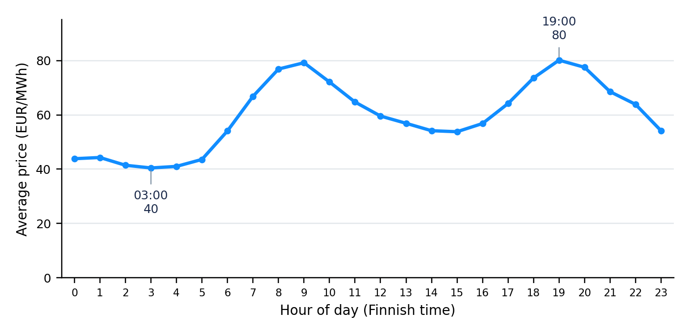
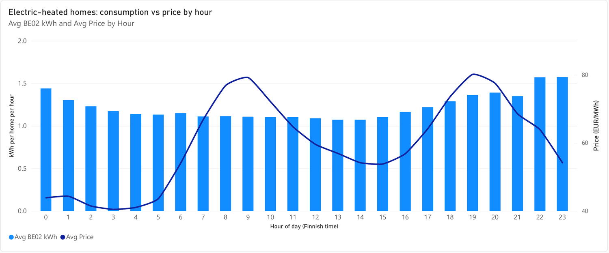
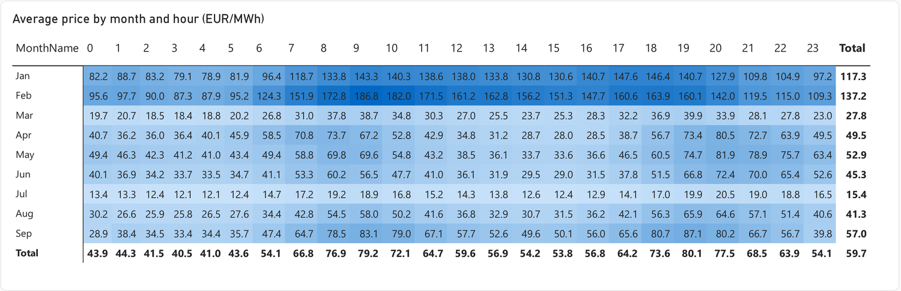
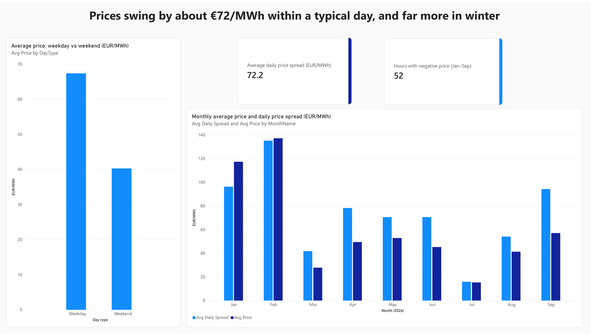
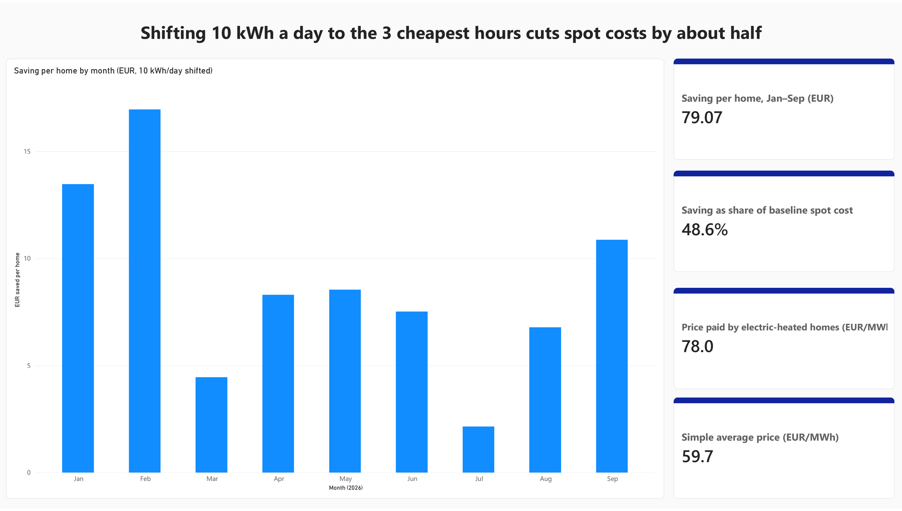

# Electricity Price Feasibility Analysis – Household Consumption

A data analysis of Finnish electricity prices and household electricity use (January to September 2026), built with Excel, Power Query, DAX and Power BI.

Student project, Data Analytics and Business Intelligence (DABI), University of Oulu.

**Power BI report:** [Open the interactive report](https://app.powerbi.com/groups/me/reports/076059f7-6e7e-4fde-a796-c80e829942ba/11de4ab212c298c4d29c?experience=power-bi)

---

## 1. What is this project?

Electricity prices in Finland change every hour, but many people with a spot-price contract do not check them. An app could follow the price, tell users the cheap hours and say which appliances to run then. AI could be added later to personalise the advice.

This project does **not** build the app. It uses data to answer one question:

> Do prices change enough during the day to help a household save money, and is the idea worth studying further?

**Answer:** yes, it is worth studying further. Prices are about twice as high at 19:00 as at 03:00, and households do not seem to move their use to the cheap hours. The biggest savings come from large loads such as EV charging and electric heating, not from small appliances.

---

## 2. Where the data comes from

| Dataset | Source | What it contains |
|---|---|---|
| Electricity consumption by user group in Finnish distribution networks (dataset 360) | Fingrid Oy / Datahub Oy, [Fingrid Open Data](https://data.fingrid.fi/en/datasets/360) | Hourly electricity use by 14 user groups and the number of metering points (91,714 rows) |
| Energy Prices [12.1.D], day-ahead, bidding zone BZN\|FI | [ENTSO-E Transparency Platform](https://transparency.entsoe.eu/) | Finnish day-ahead electricity price in EUR/MWh, one price every 15 minutes (28,988 prices) |

Appliance energy figures (used for the appliance results): Helen Oy (2017) *Sähkölaitteiden kulutuslukuja*; Helen Oy (2020) *Pyykin kuivaus*; Nordic Sun (2024) off-grid power station brochure. The EV figure (10 kWh a day) is an assumption.

The raw downloads are not stored here. Fingrid asks users to credit the source (CC BY 4.0), and ENTSO-E has its own terms of use. The files in `data/` are the cleaned and joined tables.

---

## 3. Files in this repository

| File | What it is |
|---|---|
| `data/consumption_hourly.csv` | Cleaned and joined data: one row per hour per user group (26,196 rows) with use per home and price |
| `data/daily_prices.csv` | Daily price statistics (273 days) |
| `dashboard/DABI_Energy_Model2.pbix` | Power BI report with 3 pages (open with Power BI Desktop) |
| `images/` | Output charts shown in this README |

The same report is also available online through the [Power BI link](https://app.powerbi.com/groups/me/reports/076059f7-6e7e-4fde-a796-c80e829942ba/11de4ab212c298c4d29c?experience=power-bi) at the top of this page.

### Data dictionary

**`consumption_hourly.csv`**

| Column | Meaning |
|---|---|
| HourStartUTC | Start of the hour in UTC (join key) |
| LocalTime | Start of the hour in Finnish time |
| Date, Month, MonthName, Hour | Parts of the local time |
| DayType | Weekday or Weekend |
| UserGroup, UserGroupName | BE01 apartments, BE02 electric-heated houses, BE03 other houses, BE12 EV charging points |
| kWh | Total electricity use of the group in that hour |
| Points | Number of metering points in the group |
| kWhPerPoint | kWh divided by Points (use per home) |
| Price | Day-ahead price in EUR/MWh (average of four 15-minute prices) |

**`daily_prices.csv`**

| Column | Meaning |
|---|---|
| Date, Month, MonthName | Local date |
| AvgPrice, MinPrice, MaxPrice | Daily average, lowest and highest hourly price (EUR/MWh) |
| Cheap3 | Average of the three cheapest hours of the day |
| Spread | MaxPrice minus MinPrice |
| Gap | AvgPrice minus Cheap3 |

---

## 4. How the data was prepared

1. The Fingrid file kept the user group and the number of metering points in one JSON text column, so I split them into separate columns. An empty up-regulation price column was deleted.
2. I kept apartments (BE01), electrically heated houses (BE02), other houses (BE03) and EV charging points (BE12). Industry and services were left out, because the idea is for households.
3. Both files use UTC time, so I converted them to Finnish time (daylight saving included).
4. I averaged the four 15-minute prices of each hour into one hourly price and joined price and consumption by hour: **6,549 hours and 26,196 rows**. Two hours on 31 December (UTC) had no price and were dropped.
5. No missing, duplicate or zero values were found.
6. I divided each group's kWh by its number of metering points to get use per home.

---

## 5. Findings and outputs

All numbers below come from the Power BI report and can be reproduced from the two CSV files.

### Prices during the day (Power BI page 1)

| Measure | Result |
|---|---|
| Average price, Jan to Sep 2026 | 59.7 EUR/MWh |
| Cheapest hour on average | 03:00, about 40 EUR/MWh |
| Most expensive hour on average | 19:00, about 80 EUR/MWh (twice as much) |
| Electrically heated homes: share of use in the 6 most expensive hours | 25.1% |
| Electrically heated homes: share of use in the 6 cheapest hours | 25.3% |

Electrically heated homes use almost the same share of power in cheap and expensive hours, so their use does not follow the price.







### How much prices change (Power BI page 2)

| Measure | Result |
|---|---|
| Average daily gap between the cheapest and most expensive hour | 72.2 EUR/MWh |
| Hours with a negative price | 52 |
| Average price on weekdays / weekends | 67.4 / 40.3 EUR/MWh |
| Most expensive month | February, 137.2 EUR/MWh |
| Cheapest month | July, 15.4 EUR/MWh |



### Could a household save money? (Power BI page 3)

Test case: a home moves **10 kWh a day** into the **three cheapest hours** of each day, compared with paying the day's average price.

| Measure | Result |
|---|---|
| Saving as share of baseline spot cost | 48.6% |
| Saving per home, Jan to Sep | 79.07 EUR |
| Price paid by electrically heated homes (weighted by their use) | 78.0 EUR/MWh |
| Simple average price | 59.7 EUR/MWh |

The 78.0 against 59.7 gap is mostly because electrically heated homes use more power in the cold, expensive months.



| Month | Average price (EUR/MWh) | Saving per home (EUR) | Saving (% of cost) |
|---|---|---|---|
| January | 117.3 | 13.47 | 37.1 |
| February | 137.2 | 16.96 | 44.2 |
| March | 27.8 | 4.45 | 51.6 |
| April | 49.5 | 8.31 | 55.9 |
| May | 52.9 | 8.54 | 52.1 |
| June | 45.3 | 7.52 | 55.3 |
| July | 15.4 | 2.15 | 45.1 |
| August | 41.3 | 6.79 | 53.1 |
| September | 57.0 | 10.88 | 63.6 |
| **Jan to Sep** | **59.7** | **79.07** | **48.6** |

### Which uses are worth moving?

Baseline: the average price from 17:00 to 20:59 (about 74 EUR/MWh). Alternative: the cheapest 2 or 3 hours of the day (about 30 EUR/MWh).

| Use | kWh per use | Uses per week | Saving per year (EUR) |
|---|---|---|---|
| Washing machine | 1.0 | 5 | 11.5 |
| Dishwasher | 1.0 | 5 | 11.5 |
| Tumble dryer | 2.1 | 3 | 14.4 |
| EV charging | 10 | 7 | 157.1 |

Small appliances save very little. The value is in EV charging and electric heating.

---

## 6. Power BI report

Online version: [Power BI report](https://app.powerbi.com/groups/me/reports/076059f7-6e7e-4fde-a796-c80e829942ba/11de4ab212c298c4d29c?experience=power-bi)

| Page | Question | Visuals |
|---|---|---|
| 1 | When is electricity cheap? | Line chart of price by hour, combined chart of heated-home use and price, colour matrix of price by month and hour |
| 2 | How much do prices change? | Column charts by month and by weekday vs weekend, cards for the daily gap and negative-price hours |
| 3 | Could households save money? | Column chart of saving per home by month, cards for the saving, saving share, price paid and average price |

The report has interactive filters for hour, month and weekday/weekend, so price and consumption patterns can be explored from different angles.

Main DAX measures:

```dax
AvgPrice = AVERAGE(Consumption[Price])

AvgBE02kWh =
CALCULATE(AVERAGE(Consumption[kWhPerPoint]), Consumption[UserGroup] = "BE02")

BE02WeightedPrice =
DIVIDE(
    SUMX(FILTER(Consumption, Consumption[UserGroup] = "BE02"),
         Consumption[kWhPerPoint] * Consumption[Price]),
    CALCULATE(SUM(Consumption[kWhPerPoint]), Consumption[UserGroup] = "BE02")
)

NegativePriceHours =
CALCULATE(DISTINCTCOUNT(Consumption[HourStartUTC]), Consumption[Price] < 0)

AvgDailySpread = AVERAGE(Daily[Spread])

SavingPerHome = SUM(Daily[Gap]) * 10 / 1000

SavingShare = DIVIDE(SUM(Daily[Gap]), SUM(Daily[AvgPrice]))
```

The tables are `Consumption` (`consumption_hourly.csv`) and `Daily` (`daily_prices.csv`), related on `Date` (one to many).

---

## 7. Reproduce the key numbers

```python
import pandas as pd

c = pd.read_csv("data/consumption_hourly.csv")
d = pd.read_csv("data/daily_prices.csv")
h = c[c.UserGroup == "BE02"]

print(h.Price.mean())                              
print(d.Spread.mean())                             
print(d.Gap.sum() * 10 / 1000)                     
print((h.kWhPerPoint * h.Price).sum() / h.kWhPerPoint.sum())   
print((h.Price < 0).sum())                       
```

---

## 8. Limitations

- Wholesale spot prices only. Real bills also include taxes, network charges and margins, so real savings are smaller.
- Nine months of data, so yearly figures are rough.
- Appliance and EV figures are assumptions, not data from real households.
- The cheapest hours of a day are not always next to each other, so the savings are an upper estimate.
- Some consumption readings may be estimates.
- Other electricity-price apps already exist, so a new app would need something different.

## 9. Next steps

- Repeat the analysis with a full year of data and real consumer tariffs.
- Check what existing price apps offer, and where appliance-level advice would add value.
- Test whether advice based on published day-ahead prices changes real behaviour in a small pilot.
